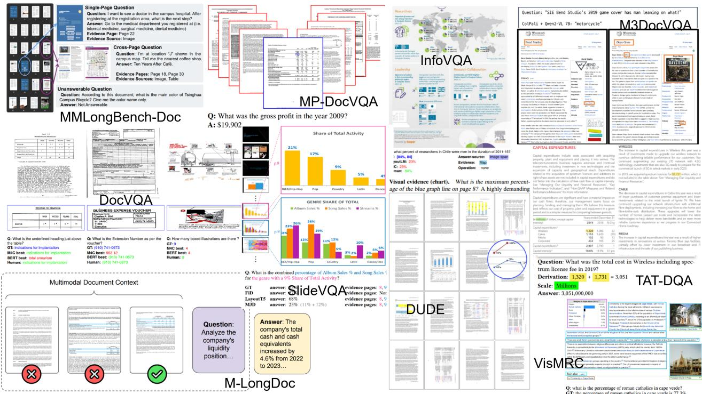

# Survey on Question Answering over Visually Rich Documents: Methods, Challenges, and Trends

Camille Barboule Orange Paris, France

Benjamin Piwowarski Sorbonne Université, CNRS, ISIR Paris, France

Yoan Chabot Orange Belfort, France

## Abstract

The field of visually-rich document understand ing, which involves interacting with visuallyrich documents (whether scanned or borndigital), is rapidly evolving and still lacks consensus on several key aspects of the processing pipeline. In this work, we provide a comprehensive overview of state-of-the-art approaches, emphasizing their strengths and limitations, pointing out the main challenges in the field, and proposing promising research directions.

## 1 Introduction

Visually-rich documents (VRDs) combine complex information, blending text with visual elements like graphics, diagrams, and tables to convey detailed content effectively (Ding et al., 2024). Unlike traditional text documents, VRDs have two main features: text associated with typographic details (e.g., font, size, style, color), layout that organize information spatially, and visual elements, such as charts and figures, which enhance comprehension (Huang et al., 2024a). These documents can be either native digital files (e.g., PDFs) containing searchable text and layout metadata, or scanned images requiring OCR to extract text and layout. Visually-rich Document Understanding (VrDU) is a rapidly evolving field at the intersection of computer vision and natural language processing, tackling both perception (document parsing, i.e. identification and extraction of objects within the document) and interpretation (downstream tasks using the document features, such as answering questions or information extraction) (Zhang et al., 2024c).

We provide a comprehensive analysis of how Visual Document Understanding (VrDU) models represent visually rich documents (VrDs) and use these features on downstream tasks, which often contain multiple elements—such as charts, tables, figures, and text—and span multiple pages (see Table 4 in appendix). Current VrDU approaches typically follow a two-step pipeline: document parsing followed by downstream tasks like question answering. We analyze how this two-step pipeline operates, looking first at how VrDU models encode VrDs, and then how large language models (LLMs) decode those features for downstream tasks.

We first take a deep dive into current approaches for processing and leveraging tokens and bounding boxes (extracted from OCR or PDF metadata) and linking textual and visual features within documents. Recent innovations aim to enable LLMs to handle the 2D positioning of elements in VrDs at different granularities and to process both textual and visual features from those documents, thereby improving their understanding of the structure and content of VrDs (Section 2).

Additionally, we examine how Large Vision-Language Models (LVLMs), which are increasingly recognized for their combined perception and reasoning capabilities, currently dominate the VrDU domain. Recent innovations focus on balancing coarse- and fine-grained visual representations of VrDs while limiting computational cost. Despite their growing popularity, we show that current LVLM architectures are still ill-suited to the specific challenges of VrDU, particularly in handling multi-page documents (Section 3).

Next, we analyze how VrDU approaches handle multi-page documents, exploring recent page-bypage strategies, strategies relying on sparse attention mechanisms to maintain connections across pages, and we finally examine retrieval-augmented generation (RAG) approaches that reduce the problem to a single-page context by retrieving relevant information from other pages, while giving insights on future promising directions (Section 4).

Finally, we compare the different approaches to optimally inject those visual information into a LLM to be processed optimally for downstream tasks, comparing self-attention and cross-attentionbased approaches (Section 5).

## 2 Encoding VrDs from structured information

VrDs can be represented through three distinct but interconnected features: text and layout, derived from native digital formats or OCR extraction, and the overall visual appearance of the document, obtained by generating a screenshot of the document page. The most important layout features are bounding boxes around text and structural elements (e.g., tables). The visual modality captures the document page appearance, encompassing the overall structure and visual context of the document as a whole. The main problematic in VRD encoding is to represent and merge the information coming from these three distinct modalities. Table 1 summarizes models from this category that we detail in this section.

## 2.1 Integrating the Layout information

The positions and sizes of elements within a document can vary in granularity, from individual tokens (Garncarek et al., 2020; Xu et al., 2019) to larger blocks like cells, tables, images, or paragraphs (Li et al., 2021a,b). This layout information can be represented within VrDU models in three ways: through absolute positional embeddings of the 2D position, as an attention bias / rotation depending on the spatial distance of the tokens, or directly within the text, as special tokens.

The simplest approach, which does not require any architectural change, is to include layout information as special tokens, directly within the text (Lu et al., 2024; Mao et al., 2024). The global text-layout sequence is based on an extended vocabulary ${ \hat { V } } = V \cup [ \mathbf { B B O X } ]$ , where V is the original text vocabulary. This approach not only increases the sequence length, overloading the model’s context window, but also limits the ability to capture complex spatial interactions between elements in the document.

This is why the VrDU community has focused on developing optimal methods to incorporate spatial information of tokens within documents. One way is to extend the 1D absolute positional encoding of tokens in transformers to 2D (see Table 1) by embedding the spatial coordinates (x, y) of each token’s bounding box. For example, LayoutLM (Xu et al., 2019) embeds the discretized x and y coordinates separately and sums them. DocFormer (Appalaraju et al., 2021) further includes embeddings for the bounding box dimensions (height and width), while UNITER (Chen et al., 2020) adds an embedding for the area of each bounding box. These embeddings can be learned or fixed (function-based, e.g., sinusoidal (Hong et al., 2022)).

However, absolute positional encoding is limited, as they are added at the input only (Chen et al., 2021). Recent models hence apply positional en coding directly within the attention mechanism for improved performance and flexibility. In particular, they extend the relative positional encoding (Press et al., 2022; Raffel et al., 2023), applied on every self-attention layers, to a 2D space. Such approaches either encode the 2D distance as a bias term added before the softmax, representing the horizontal and vertical distances between tokens within the document (Xu et al., 2022; Powalski et al., 2021), or as a rotation applied to the queries and keys vectors, depending on the absolute position of each token, inspired from 1D-RoPE (Su et al., 2023), with a rotation of the attention score depending on the horizontal position of the token (e.g. position within a table row), and another on the vertical one (e.g. position within the columns of the table), with both scores weighted by a gating model (Li et al., 2024a). Pondering the attention score with the 2D distance of the tokens is still limited, as token semantics, like "total" in tables, often dictate specific spatial interactions beyond mere positional proximity. To ensure that the model pays particular attention to tokens located at the same horizontal position of some meaningful to kens (like "total" in a table), ERNIE-Layout (Peng et al., 2022) introduces three relative position attention biases (disentangled attention), capturing respectively how the semantic meaning of a token interacts with its sequential, horizontal and vertical relative distance to the other token. FormNet (Lee et al., 2022) goes further in this direction by al lowing more complex interactions, using functions that combine semantic and position information between tokens.

To conclude, in a world where documents are increasingly digital-native, with direct access to text and bounding boxes, enabling LLMs to handle such structures is crucial. However, the community has mostly focused on adapting either 1D absolute positional encodings or relative 1D positional bias to the 2D space, while little attention has been given to extending RoPE to 2D—despite most current models relying on it.

To the best of our knowledge, only a few studies focus on the granularity of positional information, distinguishing between intra-region positions (e.g., the position of a cell within a table or a token within a paragraph) and page-level positions (e.g., the position of a token or a region within the entire page). Region-level models fail to capture cross-region and word-level interactions, while page-level models (with token-wise positions) suffer from excessive contextualization (Li et al., 2021b). We suggest that combining these two levels of granularity could enhance performance (Wang et al., 2022).

<table><tr><td>Model</td><td> $E_{Text}$ </td><td> $E_{Vis}$ </td><td> $E_{Pos}$ </td><td> $E_{Cross}$ </td><td> $D_{Text}$ </td><td>MP</td></tr><tr><td colspan="7">Interaction of text and visual features within self-attention after modalities concatenation</td></tr><tr><td>LayoutLMv2 2022</td><td>UniLMv2</td><td>ResNeXt-101-FPN</td><td>emb. tables + attn bias</td><td></td><td>transformer</td><td></td></tr><tr><td>LayoutXLM 2021</td><td>XLM-R</td><td>ResNeXt-101-FPN</td><td>emb. tables + attn bias</td><td></td><td>transformer</td><td></td></tr><tr><td>UNITER 2020</td><td>BERT</td><td>Faster R-CNN</td><td>emb. tables (7D)</td><td></td><td>transformer</td><td></td></tr><tr><td>LayoutLMv3 2022</td><td>RoBERTa</td><td>ViT</td><td>attn bias</td><td></td><td>transformer</td><td></td></tr><tr><td>DocFormerv2 2023</td><td>T5 encoder</td><td>ViT</td><td>emb. tables.</td><td></td><td>T5</td><td></td></tr><tr><td>GRAM 2024</td><td>DocFormerv2(2023)</td><td>DocFormerv2(2023)</td><td>emb. tables</td><td></td><td>DocFormerv2(2023)</td><td>√</td></tr><tr><td>LayoutLLM 2024</td><td>LayoutLMv3(2022)</td><td>LayoutLMv3(2022)</td><td>LayoutLMv3(2022)</td><td></td><td>Llama-7B</td><td></td></tr><tr><td>DocLayLLM 2024</td><td>LayoutLMv3(2022)</td><td>LayoutLMv3(2022)</td><td>LayoutLMv3(2022)</td><td></td><td>Llama3-8BInstruct</td><td></td></tr><tr><td colspan="7">Interaction of text and visual features within cross-attention</td></tr><tr><td>DocFormer 2021</td><td>LayoutLM(2019)</td><td>ResNet50</td><td>emb. tables</td><td>visual-spatial attn</td><td>transformer</td><td></td></tr><tr><td>SelfDoc 2021b</td><td>Sentence BERT</td><td>Faster R-CNN</td><td>emb. tables</td><td>intra&amp;inter-modal attn</td><td>transformer</td><td></td></tr><tr><td>ERNIE-Layout 2022</td><td>BERT</td><td>Faster R-CNN</td><td>emb. tables</td><td>Disentangled attn (2021)</td><td>transformer</td><td></td></tr><tr><td>HiVT5 2023</td><td>T5 encoder</td><td>DiT (2022)</td><td>emb. tables</td><td>VT5 encoder</td><td>VT5 decoder</td><td>√</td></tr><tr><td>DocTr 2023</td><td>LayoutLM(2019)</td><td>DETR (2020)</td><td>special tokens</td><td>Deformable DETR (2021)</td><td>LayoutLM</td><td></td></tr><tr><td>InstructDr 2024</td><td>FlanT5 encoder</td><td>CLIP VIT-L/14</td><td>emb. tables</td><td>Document-Former</td><td>FlanT5</td><td>√</td></tr><tr><td>RM-T5 2024a</td><td>T5 encoder</td><td>DiT (2022)</td><td>emb. tables</td><td>RMT (2022)</td><td>T5 decoder</td><td>√</td></tr><tr><td>Arctic-TILT 2024</td><td>T5 encoder</td><td>U-Net (per RoI)</td><td>attn bias</td><td>Tensor Product</td><td>T5</td><td>√</td></tr><tr><td colspan="7">Summing aligned text and visual features via ROI-pooling</td></tr><tr><td>TILT 2021</td><td>T5 encoder</td><td>U-Net</td><td>attn bias</td><td></td><td>T5</td><td></td></tr><tr><td>Pramanik et al. (2022)</td><td>Longformer</td><td>ResNet50 + FPN</td><td>sinusoidal emb.</td><td></td><td>transformer</td><td>√</td></tr><tr><td>UDOP 2023</td><td>T5 encoder</td><td>MAE encoder</td><td>attn bias</td><td></td><td>T5&amp;MAE decoder</td><td></td></tr></table>

Table 1: Comparison of VrDU models handling the three modalities $( \mathrm { T } { + } \mathrm { L } { + } \mathrm { V } )$ , detailing encoding of text $\mathbf { E } _ { \mathbf { T e x t } }$ visuals $\mathbf { E _ { V i s } } .$ and position $\mathbf { E } _ { \mathbf { P o s } }$ , fusion layers $\mathbf { E _ { C r o s s } }$ , decoder $\mathbf { D _ { T e x t } }$ , and multi-page (MP) support ${ \checkmark } .$

## 2.2 Integrating the visual information

In all the works we reviewed, the visual modality is transmitted as a set of visual “tokens” (vectors), computed by a visual encoder. Initially based on CNNs (Xu et al., 2022), these encoders have transitioned to Visual Transformers (ViTs) (Huang et al., 2022).

Fusing text and visual features for unified document encoding is challenging due to the differences between visual and text tokens (see Table 1). The integration of the two modalities can be done locally (per regions or the document) or globally (within the whole document).

Global modality alignment involves considering both the visual and textual features of the entire document rather than specific regions. A simple method to align those modalities globally involves concatenating them (Xu et al., 2022). A transformer encoder then allows interaction through standard self-attention mechanisms (Appalaraju et al., 2023; Huang et al., 2022). However, such approaches require intensive pretraining for features (visual and textual) alignment (Huang et al., 2022), since these two feature types form a unit within the document, sometimes representing the same elements (e.g., an image of a piece of text versus the text itself).

Local modality alignment refers to aligning text and visual features specifically within localized regions of the document, focusing solely on the text and visual attributes from those regions. These regions can be either inferred using visual information, i.e. determined by an object detection module (Carion et al., 2020; Ren et al., 2016) or determined by the textual information, i.e. considering the bounding boxes of text tokens (Powalski et al., 2021). A simple method to locally align modalities involves summing the two representations per region (Powalski et al., 2021). Note that regions without associated text only have a vision-only representation (Tang et al., 2023). However, this approach constrains the interaction between visual and textual modalities, thereby limiting the comprehensive understanding of the document region (Li et al., 2021b).

To capture interactions between textual and visual features from a region of the document, Self-Doc (Li et al., 2021b) uses two cross-attentions: from the visual to textual tokens and vice-versa, e.g. allowing the textual semantic representation to be contextualized by visual information such as color, bold elements, and position. For example, a large, bolded, centered text block is likely to serve as a title or header. By incorporating these visual cues, the model refines the semantic representation of text, ensuring that its meaning is informed by its visual context within the document. Rather than relying on costly cross-attention for modality fusion and interaction, Arctic-TILT (Borchmann et al., 2024) introduces a lightweight attention mechanism after the transformer feedforward layer to integrate visual information using a learnable role bias for text tokens, inspired by TP-Attention (Schlag et al., 2020).

To conclude, the effect of the visual features, at least in the way it is utilized in such models (i.e. enriching the textual features’ representation), appears small and may primarily introduce redundancy to the textual elements: as shown by Tang et al. (2023), adding visual features brings little to no improvement on datasets without images or visual components, and only marginally enhances performance on highly visual tasks like InfographicsVQA (Mathew et al., 2021a).

## 3 Vision-Only Encoding of VrDs

In the previous section, we discussed techniques that integrate visual and textual information. These models however remain complex because the segmentation between modalities in a document is not straightforward and may introduce redundancy, lead to information loss and require pretraining for modalities alignment.

Many recent works consider VrDs as images, which brings the advantage of dealing with a single modality, relying on a LLM decoder to handle different tasks. A summary of this type of model we detail below is provided in Table 2.

Such approaches, commonly named Large Visual-Language Models (LVLMs), demand a highly capable visual encoder to capture all textual, layout, and visual details within the document. However, ViTs themselves are not capable to capture fine details like text (Zhang et al., 2025). Indeed, in ViTs, the visual input (e.g., a document page) is divided into fixed-size patches, each becoming a "vision token" (e.g., 14x14 or 16x16 pixels). If patches are too large, they may cover too much content, like multiple lines or text fragments, and miss fine details. Using smaller patches or increasing the image resolution creates more patches, enabling the model to capture finer details and better encode the document’s textual content (Lee et al., 2023), but at the cost of efficiency.

Indeed, ViTs have a maximum context size (number of patches) they can manage (Lee et al., 2023). This is why research in vision-only VrDU focuses on architectural modifications to ViTs to enable the processing of high-resolution images (Section 3.1). An effective alternative is to use a set of pre-trained ViTs, each handling a different part of the image, thereby allowing the processing of high-resolution images more efficiently (Section 3.2). In this case, it is necessary to ensure coherence between the cropped regions of the page.

## 3.1 Architectural changes to ViT

A number of approaches leverage CNN architectures, which capture local information more efficiently than ViTs due to their intrinsic design based on convolutions, exploiting locality bias in images. Dhouib et al. (2023) proposes a sequential architecture combining CNN and ViT components, where ConvNext blocks are used to extract local features, and their output is fed into a ViT for modeling global dependencies.

Due to the complexity of combining two networks without losing information, other approaches (Kim et al., 2022; Blecher et al., 2023) draw inspiration from the local window mechanism of CNNs and incorporate it into ViTs, enabling them to process numerous patches effectively. These approaches restrict attention to a local window of patches with a Swin Transformers (Liu et al., 2021), which applies self-attention within local windows, shifting these windows across layers to efficiently integrate cross-window information. However, Swin ViTs progressively reduce the resolution of the tokens through token merging steps, which decrease the number of tokens. DocPedia (Feng et al., 2024) removes this downsampling step, keeping the full token resolution throughout the processing pipeline by leveraging the frequency domain rather than spatially merging patches as done in Swin. More precisely, they represent an image in the frequency domain, using the Discrete Cosine Transform (Liu et al., 2022a), allowing to process larger patches without loosing important high resolution information. However, restricting the attention to local windows, even if shifted, introduces a locality bias to ViTs, similar to CNNs.

More recent approaches avoid introducing a locality bias to ViTs, instead focusing on removing redundant information from ViT patches, as documents often contain a significant amount of redundancies, such as borders, whitespace or decorations. These methods either use attention scores from the self-attention mechanism to prune or merge tokens (e.g., Zhang et al. (2024b); Shang et al. (2024); Chen et al. (2024)) or employ unsupervised techniques like Dual-Center K-Means Clustering (Zhang et al., 2024a) to select tokens. TinyChart (Zhang et al., 2024b) combines similar tokens after each ViT layer using methods like average pooling, while DocKylin (Zhang et al., 2024a) employs similarity-weighted summation based on token cosine similarity ensuring that each token contributes proportionally to its relevance. Other approaches (Liu et al., 2024a) use a content detection module to filter out low-relevance areas (e.g., whitespace) and preserve meaningful regions (e.g., text or tables) by assigning probabilities to pixels and mapping them to patches.

<table><tr><td>Model</td><td>Res.</td><td> $E_{Vis}$ </td><td> $P_{EV\to DT}$ </td><td> $D_{Text}$ </td><td>MP</td></tr><tr><td colspan="6">Encoder: HR image - Decoder: Tiny Decoder</td></tr><tr><td>DONUT (Kim et al., 2022)</td><td>2560x1920</td><td>SwinT (2021)</td><td>MLP</td><td>BART</td><td></td></tr><tr><td>DESSURT (Davis et al., 2022)</td><td>1152x768</td><td>Attn-Based CNN</td><td>MLP</td><td>BART with Swin attn</td><td></td></tr><tr><td>Pix2Struct (Lee et al., 2023)</td><td>1024x1024</td><td>ViT</td><td>MLP</td><td>BART</td><td></td></tr><tr><td>SeRum (Cao et al., 2023)</td><td>1280x960</td><td>SwinT 2021</td><td>MLP</td><td>mBART</td><td></td></tr><tr><td>Kosmos2.5 (Lv et al., 2024)</td><td>224x224</td><td>Pix2Struct 2023&#x27;s ViT</td><td>Perceiver Resampler</td><td>Transformer</td><td></td></tr><tr><td colspan="6">Encoder: LR image - Decoder: LLM</td></tr><tr><td>LLaVAR (Zhang et al., 2024d)</td><td>336x336</td><td>CLIP VIT-L/14</td><td>MLP</td><td>Vicuna13B</td><td></td></tr><tr><td>Unidoc (Feng et al., 2023)</td><td>336x336</td><td>CLIP VIT-L/14</td><td>MLP</td><td>Vicuna13B</td><td></td></tr><tr><td>mPLUG-DocOwl (Ye et al., 2023a)</td><td>224x224</td><td>CLIP VIT-L/14</td><td>Visual Abstractor</td><td>Llama-7b</td><td></td></tr><tr><td>QwenVL (Bai et al., 2023)</td><td>448x448</td><td>CLIP-VIT-G/14</td><td>Cross-attn layer</td><td>Qwen-7b</td><td></td></tr><tr><td colspan="6">Encoder: HR image - Decoder: LLM thanks to HR image in subimages division (Section 3.2)</td></tr><tr><td>SPHINX (Lin et al., 2023)</td><td>1344x896</td><td>VIT &amp; ConvNext &amp; DINO &amp; QFormer</td><td>MLP</td><td>Llama2-7B</td><td></td></tr><tr><td>UREADER (Ye et al., 2023b)</td><td>2240x1792</td><td>CLIP ViT-L/14</td><td>MLP</td><td>Vicuna13B</td><td></td></tr><tr><td>Monkey (Li et al., 2024d)</td><td>1344x896</td><td>CLIP Vit-BigG</td><td>Perceiver Resampler</td><td>Qwen-7B</td><td></td></tr><tr><td>TextMonkey (Liu et al., 2024b)</td><td>1344x896</td><td>CLIP Vit-BigG</td><td>Shared Perceiver Resampler</td><td>Qwen-7B</td><td></td></tr><tr><td>mPLUG-DocOwl1.5 (Hu et al., 2024a)</td><td>2560x1920</td><td>EVA-CLIP</td><td>H-Reducer</td><td>Llama-7b + MAM</td><td></td></tr><tr><td>LLaVA-UHD (Xu et al., 2024a)</td><td>672x1088</td><td>CLIP-ViT-L</td><td>Shared perceiver Resampler</td><td>Vicuna-13B</td><td></td></tr><tr><td>InternLMXC2-4KHD (Dong et al., 2024b)</td><td>3840x1600</td><td>CLIP-ViT-L</td><td>PLoRA matrix</td><td>InternLM2-7B</td><td></td></tr><tr><td>Idefics2 (Laurençon et al., 2024)</td><td>980x980</td><td>SigLIP-SO400M</td><td>MLP</td><td>Mistral-7B-v0.1</td><td></td></tr><tr><td>TextHawk (Yu et al., 2024)</td><td>1344x1344</td><td>SigLIP-SO</td><td>Perceiver Resampler</td><td>InternLM-7B</td><td></td></tr><tr><td>TokenPacker (Li et al., 2024b)</td><td>1344x1344</td><td>CLIP-ViT-L</td><td>TokenPacker</td><td>Vicuna-13B</td><td></td></tr><tr><td>mPLUG-DocOwl2 (Hu et al., 2024b)</td><td>504x504</td><td>EVA-CLIP</td><td>H-Reducer+DocCompressor</td><td>Llama-7b + MAM</td><td>√</td></tr><tr><td colspan="6">Encoder: HR image - Decoder: LLM thanks to adaptation of ViT to capture fine-grained details (Section 3.1)</td></tr><tr><td>DocPedia (Feng et al., 2024)</td><td>2560x2560</td><td>SwinT 2022b</td><td>MLP</td><td>Vicuna-13B</td><td></td></tr><tr><td>LLaVA-PruMerge (Shang et al., 2024)</td><td>336x336</td><td>CLIP-ViT</td><td>MLP</td><td>Vicuna13B</td><td></td></tr><tr><td>CogAgent (Hong et al., 2024)</td><td>1120x1120</td><td>EVA2-CLIP &amp; CogVLM</td><td>Cross-attn layer &amp; MLP</td><td>Vicuna-13B</td><td></td></tr><tr><td>Vary (Wei et al., 2023)</td><td>1024x1024</td><td>ViTDet &amp; CLIP-ViT-L</td><td>MLP</td><td>Qwen-7B</td><td></td></tr><tr><td>Mini-Gemini (Li et al., 2024c)</td><td>2048x2048</td><td>ConvNeXt &amp; ViT-L/14</td><td>MLP</td><td>Mistral-7B</td><td></td></tr><tr><td>LLaVA-HR (Luo et al., 2024)</td><td>1024x1024</td><td>CLIP-ConvNeXt &amp; ViT-L</td><td>MLP &amp; MR-Adapter</td><td>Llama2-7B</td><td></td></tr><tr><td>TinyChart (Zhang et al., 2024b)</td><td>768x768</td><td>SigLIP</td><td>MLP</td><td>Phi-2</td><td></td></tr><tr><td>HRVDA (Liu et al., 2024a)</td><td>1536x1536</td><td>SwinT (2022b)</td><td>MLP</td><td>Llama2-7B</td><td></td></tr><tr><td>DocKylin (Zhang et al., 2024a)</td><td>1728x1728</td><td>SwinT (2022b)</td><td>MLP</td><td>Qwen-7B</td><td></td></tr></table>

Table 2: Comparison of vision-only VrDU models, detailing the input image resolution (Res), visual encoding $\mathbf { E _ { V i s } } .$ vision-to-text projection $\mathbf { P _ { E _ { V }  D _ { T } } }$ , decoder $\mathbf { D _ { T e x t } }$ , and multi-page (MP) support $\checkmark .$

## 3.2 Several ViTs to process partitioned image

Recent works have explored pipelines leveraging already pretrained ViTs to process high-resolution images cut into slices. Each ViT handles a specific portion of the image, and the resulting representations are combined (sequence of "image tokens") as the unified document representation.

The way the original image is sliced into subimages is crucial to prevent information loss. Padding preserves the aspect ratio and prevents deformation (Li et al., 2024b). Some approaches predict the optimal way to cut the original image, with pre-defined grid matching (Ye et al., 2023b) and a score function predicting the best partition (Xu et al., 2024b), resulting in a varying amount of crop. Whatever the method, models need to maintain the continuity between the different subimages representations.

A simple way to do so is through a 2D crop position encoding, which allows interaction between local images (Ye et al., 2023b). However, this approach lacks information continuity between cropped images. To alleviate salient information loss due to cropping, Liu et al. (2024b) introduces a Shifted Window Attention mechanism, enabling sliding window-based attention across subimage representations.

A more efficient approach to maintain continuity between subimages is to leverage a low-resolution document representation to guide the integration of subimages. Through a cross-attention layer, TokenPacker (Li et al., 2024b), and later mPLUG-DocOwl2 (Hu et al., 2024b), integrate the highresolution representation of regions into the lowresolution representations using cross-attention, thus interpolating these low-resolution representations with its multi-level region cues treated as reference keys and values to inject their finer information to global image view.

To conclude on vision-only approaches, we think that slicing approaches using local information from cropped image regions to complement a lowresolution global view are promising, enabling compact and efficient representations with significantly fewer tokens while maintaining essential layout and semantic details (Hu et al., 2024b). However, while this type of approach reduces computational cost for single-page processing, it is not sufficient to handle multi-page (Hu et al., 2024b).

## 4 Encoding multi-pages documents

The principal challenge in VrDU is to handle multipages documents. Multi-page documents vary in length (e.g., 20 pages in SlideVQA (Tanaka et al., 2023)), amount of tokens per document (e.g., 21214 tokens per document in MMLongBench-Doc (Ma et al., 2024c)), and cross-page information, i.e. questions requiring information from several pages of the document (e.g. 2.1% in DUDE (Landeghem et al., 2023)). To encode multipage documents, recent approaches use retrievalaugmented generation (RAG) techniques (Lewis et al., 2021) (Section 4.1). Other methods represent the document page by page (Section 4.2), enhanced with inter-page interactions inherited from long-sequence processing techniques (Section 4.3).

## 4.1 Retrieval Approach to multi-page

The retrieval approach to multi-page documents focuses on supplying to the VrDU decoder only the representation of pages with relevant information. Several levels can be used to identify the relevant element from the document: the retriever can either predict the entire relevant page (Naidu et al., 2024; Faysse et al., 2024; Ma et al., 2024b; Cho et al., 2024) or focus on specific regions within the page, such as paragraphs or images containing the elements to answer the question (Xie et al., 2024).

These approaches inherently limit either the interaction between pages or the interaction between modalities, which does not allow cross-page analysis (Ma et al., 2024c), not mentioning that they highly depend on the performance of the retriever.

## 4.2 Query-based approaches

HiVT5 (Tito et al., 2023), and later InstructDr (Tanaka et al., 2024), encode each page of the document separately, with a specific learnable token added at the start of each page. HiVT5 (Tito et al., 2023) uses the specialized [PAGE] tokens to guide the encoder in summarizing each document page based on the given question, by processing separately each page with the question, encoding all the relevant information for the next processing step into the [PAGE] token. These [PAGE] tokens representations are then concatenated and passed to the decoder to generate the final answer. To our knowledge, the only vision-only model designed for multi-page input is mPLUG-DocOwl2 (Hu et al., 2024b), which compresses each page representation into 324 tokens and adds a page token for each page. In vision-only approaches, the token length of high-resolution images (i.e., document pages) is typically too large for LLMs to handle multi-page joint understanding, necessitating extreme compression of each page representation and thus degrading performance (Hu et al., 2024b).

However, query-based approaches only allow limited cross-page reasoning, as the long sequence and diluted information across pages make it challenging to capture specific inter-page relationships (Ma et al., 2024c), the page token being not leveraged effectively.

## 4.3 Efficient encoding of multi-pages

Inspired by the ETC Global-Local Attention mechanism (Ainslie et al., 2020), GRAM (Blau et al., 2024) enables global reasoning across multiple pages through a combination of page-dedicated layers, which apply self-attention within each page representation, and document-level layers, which focus exclusively on page token embeddings in their attention computations.

Another sparse attention approach is implemented by Arctic-Tilt (Borchmann et al., 2024), employing a blockwise attention strategy limiting the attention to a chunk size, allowing to handle up to 500 pages (about 390k tokens, with 780 tokens per page on average). This method limits attention to a smaller, predefined neighborhood (≈2 pages), reducing complexity from quadratic to linear while representing cross-page information.

An alternative to sparse attention for efficient multi-page documents processing is to use a recurrent network. RM-T5 (Dong et al., 2024a) uses a Recurrent Memory Transformer (RMT) (Gupta et al., 2022) to process multi-page documents sequentially, treating each page as part of a sequence. This allows the model to carry information across pages by utilizing hidden states from previous pages. The RMT selectively retains or forgets information, capturing essential details from each page for the next encoder, with all memory cells concatenated for the decoder to generate the final answer. However, the drawbacks of RNNs are inherited, such as the lack of parallelization and the limited possible interaction of two elements (here, pages) distant in the sequence.

Overall, our view is that approaches that encode entire documents using sparse attention techniques, either global-local or blockwise, represent the future of the multi-page field, as they show great performance on cross-page reasoning (Ma et al., 2024c) over retrieval ones.

## 5 Injecting visual features into the LLM

In both approaches for encoding the VrD (structured encoding in Section 2 versus vision-only encoding in Section 3), the representation of the document contains visual features. Integrating visual features into an LLM decoder is not straightforward because it requires adapting the visual representation space into an LLM-compatible representation without losing information, while preserving some computational efficiency. We detail here how this integration is done by current VrDU approaches, and what the future directions for visual features integration into LLMs are.

## 5.1 Self-attention based approach

This self-attention approach (Laurençon et al., 2024) consists in prepending the visual representation to the prompt, allowing the model to process both visual features with the prompt together in its self-attention layers. In such approaches, visual features are projected into the LLM space via several approaches, and are optionally pooled into a shorter sequence.

Those methods vary in complexity, ranging from direct linear projection using a single layer to map visual tokens to the expected input format of the language model (Lee et al., 2023), which minimizes the number of parameters; convolutional approaches (Cha et al., 2024), which reduce the dimensionality of the visual representation; to using learnable queries (Li et al., 2023a; Bai et al., 2023), used to retrieve relevant visual tokens.

Since interactions within visual tokens are already handled by the vision encoder in vision-only approaches, Ma et al. (2024a) modify the selfattention mechanism of the LLM by a Composite-Attention, removing interactions within the LLM within visual tokens; text tokens act as queries, with both visual and text tokens serving as keys and values.

These approaches are limited, considering raw tokens of the textual prompt and visual tokens from the document at the same level, without distinguishing between their respective roles or significance.

## 5.2 Cross-attention based approach

In the cross-attention-based approach, visual hidden states encoded by the visual encoder are used to condition a frozen LLM using freshly initialized cross-attention layers which are interleaved between the pretrained LLM layers (Laurençon et al., 2024). Unlike self-attention, cross-attention approach enables a separate consideration of prompt and visual document tokens. Flamingo (Alayrac et al., 2022) pioneered this approach with its Perceiver Resampler, which has since been adopted in various VrDU models (see Table 2).

An advantage of using cross-attention is that it allows to process longer sequences from the encoder, and thus to use only high-resolution representations. For instance, CogAgent (Hong et al., 2024) employs a high-resolution encoder connected to the decoder through a cross-attention layer, while using self-attention with a low resolution version of the image.

In other words, cross-attention approaches for integrating visual features into LLMs enable the query/prompt tokens to explicitly interact with visual features, effectively leveraging the LLM’s capabilities.

However, these methods require the introduction of many new parameters, as cross-attention layers are interleaved with the LLM’s architecture, significantly increasing the overall model size (Laurençon et al., 2024).

## 5.3 Pretraining for visual features insertion

Hu et al. (2024a) highlight that, to integrate visual features into an LLM, VrDU models must be pretrained on document parsing tasks. Lee et al. (2023); Wei et al. (2023); Blecher et al. (2023); Hu et al. (2024a); Kim et al. (2022) exploit the fact that documents are often generated from a symbolic source document (e.g. HTML, latex, Markdown, extended Markdown format for table and charts or CSV/JSON) to convert document page screenshot into structured text for pretraining. Hu et al. (2024a) implements a multi-format reconstruction task named Unified Structured Learning.

## 6 Conclusion and Discussion

While vision-only methods (Section 3) are gaining prominence in recent literature, they face significant challenges in balancing coarse and finegrained VrD representations. This often results in excessive computational complexity or compression issues, making these methods unsuitable for multi-page document processing without a retriever (see Table 3). For multi-page understanding, we argue that multi-modal approaches—combining textual, visual, and positional features—are more efficient (see Table 3).

In addition to the computational cost aspect, our view is that the community should prioritize developing methods to handle text, layout, and visual elements in documents, as we observe that documents are increasingly becoming digital-native, with bounding boxes and text readily accessible. However, these approaches remain challenging due to the need for effective alignment across textual and visual features, and due to the need for LLM to handle 2D positional information efficiently.

To reduce redundant information between textual and visual features (Tang et al., 2023) and handle both information in an optimal way, we suggest focusing on integrating textual features within the visual representation using cross-attention mechanisms (Li et al., 2021b) with text guiding the integration (query) when visual elements are less prominent in the document (Borchmann et al., 2024), and visual features guiding when visual elements are major in documents.

Our view is that the community should focus on developing methods to effectively process 2D information, exploring aspects such as granularity, the semantic connection to 2D positions, and multi-level attention mechanisms—both between semantically meaningful blocks and within those blocks, and adapting 2D position encoding to recent approaches (Su et al., 2023). As shown in Table 3, models that make extensive use of positional features—such as ERNIE-Layout (Peng et al., 2022) and Arctic-TILT (Borchmann et al., 2024) – have the best results. This indicates that text and layout information are essential for answering questions, even in complex charts and figures, making efficient layout handling critical.

<table><tr><td>Models</td><td>Doc VQA</td><td>Info VQA</td><td>DUDE</td><td>MPDoc VQA</td></tr><tr><td colspan="5">T+L+V models (Section 2)</td></tr><tr><td>LayoutLMv3 2022</td><td>83.4</td><td>45.1</td><td> $20.3^2$ </td><td> $55.3^2$ </td></tr><tr><td>ERNIE-Layout 2022</td><td>88.4</td><td></td><td></td><td></td></tr><tr><td>DocFormerv2 2023</td><td>87.8</td><td>48.8</td><td> $50.8^2$ </td><td> $76.8^2$ </td></tr><tr><td>HiVT5 2023</td><td></td><td></td><td>23.0</td><td>62.0</td></tr><tr><td>GRAM 2024</td><td>86.0</td><td></td><td>53.4</td><td>80.3</td></tr><tr><td>LayoutLLM 2024</td><td>86.9</td><td></td><td></td><td></td></tr><tr><td>DocLayLLM 2024</td><td>78.4</td><td>40.9</td><td></td><td></td></tr><tr><td>TILT 2021</td><td>87.1</td><td></td><td></td><td></td></tr><tr><td>UDOP 2023</td><td>84.7</td><td>47.4</td><td></td><td></td></tr><tr><td>ViTLP 2024</td><td>65.9</td><td>28.7</td><td></td><td></td></tr><tr><td>Arctic-TILT 2024</td><td>90.2</td><td>57.0</td><td>58.1</td><td>81.2</td></tr><tr><td colspan="5">Vision-only models (Section 3)</td></tr><tr><td>DONUT 2022</td><td>72.1</td><td>11.6</td><td></td><td></td></tr><tr><td>DESSURT 2022</td><td>63.2</td><td></td><td></td><td></td></tr><tr><td>Pix2Struct 2023</td><td>76.6</td><td>40.0</td><td></td><td>62.0*</td></tr><tr><td>SeRum 2023</td><td>77.9</td><td></td><td></td><td></td></tr><tr><td>Kosmos2.5 2024</td><td>81.1</td><td>41.3</td><td></td><td></td></tr><tr><td>LLaVAR 2024d</td><td>6.73</td><td>12.3</td><td></td><td></td></tr><tr><td>Unidoc 2023</td><td>7.70</td><td>14.7</td><td></td><td></td></tr><tr><td>DocPedia 2024</td><td>47.8</td><td>15.2</td><td></td><td></td></tr><tr><td>CogAgent 2024</td><td>81.6</td><td>44.5</td><td></td><td></td></tr><tr><td>Vary 2023</td><td>76.3</td><td></td><td></td><td></td></tr><tr><td>mPLUGDoc 2023a</td><td>62.2</td><td>38.2</td><td></td><td></td></tr><tr><td>QwenVL 2023</td><td>65.1</td><td>35.4</td><td></td><td>84.4*</td></tr><tr><td>UREADER 2023b</td><td>65.4</td><td>42.2</td><td></td><td></td></tr><tr><td>Monkey 2024d</td><td>66.5</td><td>36.1</td><td></td><td></td></tr><tr><td>TextSquare 2024</td><td>84.3</td><td>51.5</td><td></td><td></td></tr><tr><td>TextMonkey 2024b</td><td>73.0</td><td>28.6</td><td></td><td></td></tr><tr><td>mPLUGDoc1.5 2024a</td><td>82.2</td><td>50.7</td><td></td><td></td></tr><tr><td>ILMXC24KHD 2024b</td><td>90.0</td><td>68.6</td><td>56.1*</td><td>76.9*</td></tr><tr><td>Idefics2 2024</td><td>74.0</td><td></td><td></td><td>56.0*</td></tr><tr><td>TextHawk 2024</td><td>76.4</td><td>50.6</td><td></td><td></td></tr><tr><td>TokenPacker 2024b</td><td>70.0</td><td></td><td></td><td></td></tr><tr><td>mPLUGDoc2 2024b</td><td>80.7</td><td>46.4</td><td>46.8</td><td>69.4</td></tr><tr><td>HRVDA 2024a</td><td>72.1</td><td>43.5</td><td></td><td></td></tr><tr><td>DocKylin 2024a</td><td>77.3</td><td>46.6</td><td></td><td></td></tr><tr><td colspan="5">Commercial Models</td></tr><tr><td>GPT-4V</td><td>88.4</td><td>75.1</td><td></td><td></td></tr><tr><td>GPT-4o</td><td>92.8</td><td></td><td>54.0</td><td>67.0</td></tr></table>

Table 3: Average Normalized Levenshtein Similarity (ANLS) on single and multi-page VQA. ² denotes Single-page-native models concatenating page representations for multi-page; \* denotes models using a retriever (PDF-Wukong (Xie et al., 2024) for InternLMXComposer2-4KHD, Naidu et al. (2024) for Pix2Struct, M3DocRAG (Cho et al., 2024) for QwenVL and Idefics2). The top-3 scores are in bold.

## 7 Limitations

A first limitation of our survey lies in the lack of consistent evaluation across different techniques. While we discuss a range of methods—such as 2D position encoding strategies, approaches for integrating visual and textual information, projectors between the visual encoder output and the LLM decoder, sparse attention approaches for multi-page document handling, ... – these techniques are evaluated in their original experimental setups, which differ in terms of model architecture, training protocols, and datasets. As a result, it is challenging to draw definitive conclusions about which technique performs best in a given scenario. Although a fairer and more scientifically rigorous comparison would require benchmarking all methods under the same conditions, this was beyond the scope of our survey due to time and resource limitations.

A further limitation of this survey is that most of the comparisons in this survey are based on benchmarks for visual question answering (VQA), while we overlook several traditional document understanding tasks. These tasks include key information extraction, document layout analysis, document classification, or reading order prediction (beyond others), which are essential for many real-world applications such as automatic form processing, contract analysis, and archival document digitization. Our focus on VQA benchmarks is primarily motivated by their widespread use in recent research as a comprehensive testbed for evaluating VrDU approaches both in their information extraction and reasoning capabilities.

Additionally, we focus exclusively on transformer-based approaches. While this choice aligns with the current state of the art, it inevitably excludes earlier yet significant contributions. For instance, traditional methods leveraging LSTMs or Gated Recurrent Units have been widely used in VrDU. More recent work has also started exploring alternative architectures such as state space models (Hu et al., 2025). Graph-Based Relationship Modeling approaches, representing documents as hierarchical structures and employing graph neural networks (GNNs) to model relationships between document elements, are also extensively adopted by the community (Dai et al., 2024; Zhang et al., 2022; Li et al., 2023b). Due to space and scope constraints, we focused on transformers, which dominate current research and offer a unified framework for integrating visual and textual modalities.

Finally, this survey focuses primarily on generic multi-element documents, such as PDFs and Power-Point slides, as illustrated in Figure 1 in appendix, rather than specific document types (e.g., tables, charts, or diagrams). Our decision to concentrate on general-purpose documents stems from the desire to provide a broad overview that covers documents combining multiple data types rather than diving into domain-specific challenges. Each specific domain—such as table understanding or chart interpretation—presents its own unique challenges and innovations, like cell, row and columns understanding for table, with approaches modeling column-wise and row-wise self-attention (Yin et al., 2020; Deng et al., 2020), derendering tasks for Charts, with approach converting chart image into their Matplotlib code (Al-Shetairy et al., 2024) with their associated JSON/CSV (Liu et al., 2023), or structure analysis tasks for diagrams, aiming at linking the legend to the diagram content (Huang et al., 2024b), which are beyond the scope of this survey.

## References

Joshua Ainslie, Santiago Ontañón, Chris Alberti, Philip Pham, Anirudh Ravula, Sumit Sanghai, Zhuyun Meng, and Lana Hou. 2020. Etc: Encoding long and structured data in transformers. arXiv preprint arXiv:2004.08483.

Mirna Al-Shetairy, Hanan Hindy, Dina Khattab, and Mostafa M. Aref. 2024. Transformers utilization in chart understanding: A review of recent advances and future trends. Preprint, arXiv:2410.13883.

Jean-Baptiste Alayrac, Jeff Donahue, Pauline Luc, Antoine Miech, Iain Barr, Yana Hasson, Karel Lenc, Arthur Mensch, Katie Millican, Malcolm Reynolds, Roman Ring, Eliza Rutherford, Serkan Cabi, Tengda Han, Zhitao Gong, Sina Samangooei, Marianne Monteiro, Jacob Menick, Sebastian Borgeaud, Andrew Brock, Aida Nematzadeh, Sahand Sharifzadeh, Mikolaj Binkowski, Ricardo Barreira, Oriol Vinyals, Andrew Zisserman, and Karen Simonyan. 2022. Flamingo: a visual language model for few-shot learning. Preprint, arXiv:2204.14198.

Srikar Appalaraju, Bhavan Jasani, Bhargava Urala Kota, Yusheng Xie, and R. Manmatha. 2021. Docformer: End-to-end transformer for document understanding. Preprint, arXiv:2106.11539.

Srikar Appalaraju, Peng Tang, Qi Dong, Nishant Sankaran, Yichu Zhou, and R. Manmatha. 2023. Docformery2: Local features for document understanding. Preprint, arXiv:2306.01733.

Jinze Bai, Shuai Bai, Shusheng Yang, Shijie Wang, Sinan Tan, Peng Wang, Junyang Lin, Chang Zhou, and Jingren Zhou. 2023. Qwen-vl: A versatile vision language model for understanding, localization, text reading, and beyond. Preprint, arXiv:2308.12966.

Tsachi Blau, Sharon Fogel, Roi Ronen, Alona Golts, Roy Ganz, Elad Ben Avraham, Aviad Aberdam, Shahar Tsiper, and Ron Litman. 2024. Gram: Global reasoning for multi-page vqa. Preprint, arXiv:2401.03411

Lukas Blecher, Guillem Cucurull, Thomas Scialom, and Robert Stojnic. 2023. Nougat: Neural optical understanding for academic documents. Preprint, arXiv:2308.13418

Borchmann, Michal Pietruszka, Wojciech Ja’skowski, Dawid Jurkiewicz, Piotr Halama, Pawel J’oziak, Lukasz Garncarek, Pawel Liskowski, Karolina Szyndler, Andrzej Gretkowski, Julita Oltusek, Gabriela Nowakowska, Artur Zawlocki, Lukasz Duhr, Pawel Dyda, and Michal Turski. 2024. Arctic-tilt. business document understanding at sub-billion scale. ArXiv, abs/2408.04632.

Haoyu Cao, Changcun Bao, Chaohu Liu, Huang Chen, Kun Yin, Hao Liu, Yinsong Liu, Deqiang Jiang, and Xing Sun. 2023. Attention where it matters: Rethinking visual document understanding with selective region concentration. Preprint, arXiv:2309.01131.

Nicolas Carion, Francisco Massa, Gabriel Synnaeve, Nicolas Usunier, Alexander Kirillov, and Sergey Zagoruyko. 2020. End-to-end object detection with transformers. Preprint, arXiv:2005.12872.

Junbum Cha, Wooyoung Kang, Jonghwan Mun, and Byungseok Roh. 2024. Honeybee: Localityenhanced projector for multimodal llm. Preprint, arXiv:2312.06742

Liang Chen, Haozhe Zhao, Tianyu Liu, Shuai Bai, Junyang Lin, Chang Zhou, and Baobao Chang. 2024. An image is worth 1/2 tokens after layer 2: Plug-andplay inference acceleration for large vision-language models. Preprint, arXiv:2403.06764.

Pu-Chin Chen, Henry Tsai, Srinadh Bhojanapalli, Hyung Won Chung, Yin-Wen Chang, and Chun-Sung Ferng. 2021. A simple and effective positional encoding for transformers. Preprint, arXiv:2104.08698.

Yen-Chun Chen, Linjie Li, Licheng Yu, Ahmed El Kholy, Faisal Ahmed, Zhe Gan, Yu Cheng, and Jingjing Liu. 2020. Uniter: Universal image-text representation learning. Preprint, arXiv:1909.11740.

Yew Ken Chia, Liying Cheng, Hou Pong Chan, Chaoqun Liu, Maojia Song, Sharifah Mahani Aljunied, Soujanya Poria, and Lidong Bing. 2024. M-longdoc: A benchmark for multimodal super-long document understanding and a retrieval-aware tuning framework. Preprint, arXiv:2411.06176.

Jaemin Cho, Debanjan Mahata, Ozan Irsoy, Yujie He, and Mohit Bansal. 2024. M3docrag: Multi-modal retrieval is what you need for multipage multi-document understanding. Preprint, arXiv:2411.04952.

He-Sen Dai, Xiao-Hui Li, Fei Yin, Xudong Yan, Shuqi Mei, and Cheng-Lin Liu. 2024. Graphmllm: A graphbased multi-level layout language-independent model for document understanding. In IEEE International Conference on Document Analysis and Recognition.

Brian Davis, Bryan Morse, Bryan Price, Chris Tensmeyer, Curtis Wigington, and Vlad Morariu. 2022. End-to-end document recognition and understanding with dessurt. Preprint, arXiv:2203.16618.

Xiang Deng, Huan Sun, Alyssa Lees, You Wu, and Cong Yu. 2020. Turl: Table understanding through representation learning. Preprint, arXiv:2006.14806.

Mohamed Dhouib, Ghassen Bettaieb, and Aymen Shabou. 2023. Docparser: End-to-end ocr-free information extraction from visually rich documents. Preprint, arXiv:2304.12484.

Yihao Ding, Jean Lee, and Soyeon Caren Han. 2024. Deep learning based visually rich document content understanding: A survey. Preprint, arXiv:2408.01287

Qi Dong, Lei Kang, and Dimosthenis Karatzas. 2024a. Multi-page document vqa with recurrent memory transformer. In International Workshop on Document Analysis Systems.

Xiaoyi Dong, Pan Zhang, Yuhang Zang, Yuhang Cao, Bin Wang, Linke Ouyang, Songyang Zhang, Haodong Duan, Wenwei Zhang, Yining Li, Hang Yan, Yang Gao, Zhe Chen, Xinyue Zhang, Wei Li, Jingwen Li, Wenhai Wang, Kai Chen, Conghui He, Xingcheng Zhang, Jifeng Dai, Yu Qiao, Dahua Lin, and Jiaqi Wang. 2024b. Internlm-xcomposer2-4khd: A pioneering large vision-language model handling resolutions from 336 pixels to 4k hd. Preprint, arXiv:2404.06512.

Manuel Faysse, Hugues Sibille, Tony Wu, Bilel Omrani, Gautier Viaud, Céline Hudelot, and Pierre Colombo. 2024. Colpali: Efficient document retrieval with vision language models. Preprint, arXiv:2407.01449.

Hao Feng, Qi Liu, Hao Liu, Jingqun Tang, Wengang Zhou, Houqiang Li, and Can Huang. 2024. Docpedia: Unleashing the power of large multimodal model in the frequency domain for versatile document understanding. Preprint, arXiv:2311.11810.

Hao Feng, Zijian Wang, Jingqun Tang, Jinghui Lu, Wengang Zhou, Houqiang Li, and Can Huang. 2023. Unidoc: A universal large multimodal model for simultaneous text detection, recognition, spotting and understanding. Preprint, arXiv:2308.11592.

Masato Fujitake. 2024. Layoutllm: Large language model instruction tuning for visually rich document d di Preprint i 5

Lukasz Garncarek, Rafal Powalski, Tomasz Stanislawek, Bartosz Topolski, Piotr Halama, Michał Turski, and Filip Grali’nski. 2020. Lambert: Layoutaware language modeling for information extraction. In IEEE International Conference on Document Anal ysis and Recognition.

Simone Giovannini, Fabio Coppini, Andrea Gemelli, and Simone Marinai. 2025. Boundingdocs: a unified dataset for document question answering with spatial annotations. Preprint, arXiv:2501.03403.

Prashant Gupta, Daniel Borchmann, Alvaro Dossantos, and Umapada Pal. 2022. Recurrent memory transformer. arXiv preprint arXiv:2207.06881.

Pengcheng He, Xiaodong Liu, Jianfeng Gao, and Weizhu Chen. 2021. Deberta: Decodingenhanced bert with disentangled attention. Preprint, arXiv:2006.03654.

Teakgyu Hong, Donghyun Kim, Mingi Ji, Wonseok Hwang, Daehyun Nam, and Sungrae Park. 2022. Bros: A pre-trained language model focusing on text and layout for better key information extraction from documents. Preprint, arXiv:2108.04539.

Wenyi Hong, Weihan Wang, Qingsong Lv, Jiazheng Xu, Wenmeng Yu, Junhui Ji, Yan Wang, Zihan Wang, Yuxuan Zhang, Juanzi Li, Bin Xu, Yuxiao Dong, Ming Ding, and Jie Tang. 2024. Cogagent: A visual language model for gui agents. Preprint, arXiv:2312.08914.

Anwen Hu, Haiyang Xu, Jiabo Ye, Ming Yan, Liang Zhang, Bo Zhang, Chen Li, Ji Zhang, Qin Jin, Fei Huang, and Jingren Zhou. 2024a. mplug-docowl 1.5: Unified structure learning for ocr-free document understanding. Preprint, arXiv:2403.12895.

Anwen Hu, Haiyang Xu, Liang Zhang, Jiabo Ye, Ming Yan, Ji Zhang, Qin Jin, Fei Huang, and Jingren Zhou. 2024b. mplug-docowl2: High-resolution compressing for ocr-free multi-page document understanding. Preprint, arXiv:2409.03420.

Pengfei Hu, Zhenrong Zhang, Jiefeng Ma, Shuhang Liu, Jun Du, and Jianshu Zhang. 2025. Docmamba: Efficient document pre-training with state space model. Preprint, arXiv:2409.11887.

Jiani Huang, Haihua Chen, Fengchang Yu, and Wei Lu. 2024a. From detection to application: Recent advances in understanding scientific tables and figures. ACM Comput. Surv., 56(10).

Jiani Huang, Haihua Chen, Fengchang Yu, and Wei Lu. 2024b. From detection to application: Recent advances in understanding scientific tables and figures. ACM Comput. Surv., 56(10).

Yupan Huang, Tengchao Lv, Lei Cui, Yutong Lu, and Furu Wei. 2022. Layoutlmv3: Pre-training for document ai with unified text and image masking. Preprint, arXiv:2204.08387.

Geewook Kim, Teakgyu Hong, Moonbin Yim, Jeongyeon Nam, Jinyoung Park, Jinyeong Yim, Wonseok Hwang, Sangdoo Yun, Dongyoon Han, and Seunghyun Park. 2022. Ocr-free document understanding transformer. Preprint, arXiv:2111.15664.

Jordy Van Landeghem, Rubén Tito, Łukasz Borchmann, Michał Pietruszka, Paweł Józiak, Rafał Powalski, Dawid Jurkiewicz, Mickaël Coustaty, Bertrand Ackaert, Ernest Valveny, Matthew Blaschko, Sien Moens, and Tomasz Stanisławek. 2023. Document understanding dataset and evaluation (dude). Preprint, arXiv:2305.08455.

Hugo Laurençon, Léo Tronchon, Matthieu Cord, and Victor Sanh. 2024. What matters when building vision-language models? Preprint, arXiv:2405.02246.

Junlong Lee, Yiheng Xu, Yang Xiao, Huan Wang, Jinlong Zhao, Pengchuan Xie, Miao Xu, Baolin Shi, and Lei Xu. 2022. Formnet: Structural encoding beyond sequential modeling in form document information extraction. arXiv preprint arXiv:2203.08411.

Kenton Lee, Mandar Joshi, Iulia Turc, Hexiang Hu, Fangyu Liu, Julian Eisenschlos, Urvashi Khandelwal, Peter Shaw, Ming-Wei Chang, and Kristina Toutanova. 2023. Pix2struct: Screenshot parsing as pretraining for visual language understanding. Preprint, arXiv:2210.03347.

Patrick Lewis, Ethan Perez, Aleksandra Piktus, Fabio Petroni, Vladimir Karpukhin, Naman Goyal, Heinrich Küttler, Mike Lewis, Wen tau Yih, Tim Rocktäschel, Sebastian Riedel, and Douwe Kiela. 2021. Retrieval-augmented generation for knowledgeintensive nlp tasks. Preprint, arXiv:2005.11401.

Chenliang Li, Bin Bi, Ming Yan, Wei Wang, Songfang Huang, Fei Huang, and Luo Si. 2021a. Structurallm: Structural pre-training for form understanding. Preprint, arXiv:2105.11210.

Jia-Nan Li, Jian Guan, Wei Wu, Zhengtao Yu, and Rui Yan. 2024a. 2d-tpe: Two-dimensional positional encoding enhances table understanding for large language models. Preprint, arXiv:2409.19700.

Junlong Li, Yiheng Xu, Tengchao Lv, Lei Cui, Cha Zhang, and Furu Wei. 2022. Dit: Self-supervised pretraining for document image transformer. Preprint, arXiv:2203.02378.

Junnan Li, Dongxu Li, Silvio Savarese, and Steven Hoi. 2023a. Blip-2: Bootstrapping language-image pretraining with frozen image encoders and large language models. Preprint, arXiv:2301.12597.

Peizhao Li, Jiuxiang Gu, Jason Kuen, Vlad I. Morariu, Handong Zhao, Rajiv Jain, Varun Manjunatha, and Hongfu Liu. 2021b. Selfdoc: Self-supervised document representation learning. Preprint i 6

Peng Li, Xiaotang Zhao, Wei Fang, et al. 2024b. Tokenpacker: Efficient visual projector for multimodal llm. arXiv preprint arXiv:2407.02392.

Qiwei Li, Z. Li, Xiantao Cai, Bo Du, and Hai Zhao. 2023b. Enhancing visually-rich document understanding via layout structure modeling. Proceedings ofthe 31st ACM International Conference on Multimedia.

Yanwei Li, Yuechen Zhang, Chengyao Wang, Zhisheng Zhong, Yixin Chen, Ruihang Chu, Shaoteng Liu, and Jiaya Jia. 2024c. Mini-gemini: Mining the potential of multi-modality vision language models. Preprint, arXiv:2403.18814

Zhang Li, Biao Yang, Qiang Liu, Zhiyin Ma, Shuo Zhang, Jingxu Yang, Yabo Sun, Yuliang Liu, and Xiang Bai. 2024d. Monkey: Image resolution and text label are important things for large multi-modal models. Preprint, arXiv:2311.06607.

Haofu Liao, Aruni RoyChowdhury, Weijian Li, Ankan Bansal, Yuting Zhang, Zhuowen Tu, Ravi Kumar Satzoda, R. Manmatha, and Vijay Mahadevan. 2023. Doctr: Document transformer for structured information extraction in documents. Preprint, arXiv:2307.07929.

Wenhui Liao, Jiapeng Wang, Hongliang Li, Chengyu Wang, Jun Huang, and Lianwen Jin. 2024. Doclayllm: An efficient and effective multi-modal extension of large language models for text-rich document understanding. Preprint, arXiv:2408.15045.

Ziyi Lin, Chris Liu, Renrui Zhang, Peng Gao, Longtian Qiu, Han Xiao, Han Qiu, Chen Lin, Wenqi Shao, Keqin Chen, Jiaming Han, Siyuan Huang, Yichi Zhang, Xuming He, Hongsheng Li, and Yu Qiao. 2023. Sphinx: The joint mixing of weights, tasks, and visual embeddings for multi-modal large language models. Preprint, arXiv:2311.07575.

Chaohu Liu, Kun Yin, Haoyu Cao, Xinghua Jiang, Xin Li, Yinsong Liu, Deqiang Jiang, Xing Sun, and Linli Xu. 2024a. Hrvda: High-resolution visual document assistant. Preprint, arXiv:2404.06918.

Fangyu Liu, Julian Martin Eisenschlos, Francesco Piccinno, Syrine Krichene, Chenxi Pang, Kenton Lee, Mandar Joshi, Wenhu Chen, Nigel Collier, and Yasemin Altun. 2023. Deplot: One-shot visual language reasoning by plot-to-table translation. Preprint, arXiv:2212.10505.

Hao Liu, Xinghua Jiang, Xin Li, Antai Guo, Deqiang Jiang, and Bo Ren. 2022a. The devil is in the frequency: Geminated gestalt autoencoder for self-supervised visual pre-training. Preprint, arXiv:2204.08227.

Yuliang Liu, Biao Yang, Qiang Liu, Zhang Li, Zhiyin Ma, Shuo Zhang, and Xiang Bai. 2024b. Textmonkey: An ocr-free large multimodal model for understanding document. Preprint, arXiv:2403.04473.

Ze Liu, Han Hu, Yutong Lin, Zhuliang Yao, Zhenda Xie, Yixuan Wei, Jia Ning, Yue Cao, Zheng Zhang, Li Dong, Furu Wei, and Baining Guo. 2022b. Swin transformer v2: Scaling up capacity and resolution. Preprint, arXiv:2111.09883.

Ze Liu, Yutong Lin, Yue Cao, Han Hu, Yixuan Wei, Zheng Zhang, Stephen Lin, and Baining Guo. 2021. Swin transformer: Hierarchical vision transformer using shifted windows. Preprint, arXiv:2103.14030.

Junyu Lu, Dixiang Zhang, Songxin Zhang, Zejian Xie, Zhuoyang Song, Cong Lin, Jiaxing Zhang, Bingyi Jing, and Pingjian Zhang. 2024. Lyrics: Boosting fine-grained language-vision alignment and comprehension via semantic-aware visual objects. Preprint, arXiv:2312.05278.

Gen Luo, Yiyi Zhou, Yuxin Zhang, Xiawu Zheng, Xiaoshuai Sun, and Rongrong Ji. 2024. Feast your eyes: Mixture-of-resolution adaptation for multimodal large language models. Preprint, arXiv:2403.03003.

Tengchao Lv, Yupan Huang, Jingye Chen, Yuzhong Zhao, Yilin Jia, Lei Cui, Shuming Ma, Yaoyao Chang, Shaohan Huang, Wenhui Wang, Li Dong, Weiyao Luo, Shaoxiang Wu, Guoxin Wang, Cha Zhang, and Furu Wei. 2024. Kosmos-2.5: A multimodal literate model. Preprint, arXiv:2309.11419.

Feipeng Ma, Yizhou Zhou, Hebei Li, Zilong He, Siying Wu, Fengyun Rao, Yueyi Zhang, and Xiaoyan Sun. 2024a. Ee-mllm: A data-efficient and computeefficient multimodal large language model. arXiv preprint arXiv:2408.11795.

Xueguang Ma, Sheng-Chieh Lin, Minghan Li, Wenhu Chen, and Jimmy Lin. 2024b. Unifying multimodal retrieval via document screenshot embedding. Preprint, arXiv:2406.11251.

Yubo Ma, Yuhang Zang, Liangyu Chen, Meiqi Chen, Yizhu Jiao, Xinze Li, Xinyuan Lu, Ziyu Liu, Yan Ma, Xiaoyi Dong, Pan Zhang, Liangming Pan, Yu-Gang Jiang, Jiaqi Wang, Yixin Cao, and Aixin Sun. 2024c. MMLongBench-Doc: Benchmarking Long-context Document Understanding with Visualizations. arXiv preprint arXiv:2407.01523.

Zhiming Mao, Haoli Bai, Lu Hou, Jiansheng Wei, Xin Jiang, Qun Liu, and Kam-Fai Wong. 2024. Visually guided generative text-layout pre-training for document intelligence. Preprint, arXiv:2403.16516.

Minesh Mathew, Viraj Bagal, Rubèn Pérez Tito, Dimosthenis Karatzas, Ernest Valveny, and C. V Jawahar. 2021a. Infographicvqa. Preprint, arXiv:2104.12756.

Minesh Mathew, Dimosthenis Karatzas, and C. V. Jawahar. 2021b. Docvqa: A dataset for vqa on document images. Preprint, arXiv:2007.00398.

Chaitanya Naidu, Mohammad Khan, and C. V. Jawahar. 2024. Multi-page document visual question answering using self-attention scoring mechanism. arXiv preprint arXiv:2404.19024.

Qiming Peng, Yinxu Pan, Wenjin Wang, Bin Luo, Zhenyu Zhang, Zhengjie Huang, Teng Hu, Weichong Yin, Yongfeng Chen, Yin Zhang, Shikun Feng, Yu Sun, Hao Tian, Hua Wu, and Haifeng Wang. 2022. Ernie-layout: Layout knowledge enhanced pre-training for visually-rich document understand ing. Preprint, arXiv:2210.06155.

Rafał Powalski, Łukasz Borchmann, Dawid Jurkiewicz, Tomasz Dwojak, Michał Pietruszka, and Gabriela Pałka. 2021. Going full-tilt boogie on document understanding with text-image-layout transformer. Preprint, arXiv:2102.09550.

Subhojeet Pramanik, Shashank Mujumdar, and Hima Patel. 2022. Towards a multi-modal, multi-task learning based pre-training framework for document representation learning. Preprint, arXiv:2009.14457.

Ofir Press, Noah A. Smith, and Mike Lewis. 2022. Train short, test long: Attention with linear biases enables input length extrapolation. Preprint, arXiv:2108.12409.

Colin Raffel, Noam Shazeer, Adam Roberts, Katherine Lee, Sharan Narang, Michael Matena, Yanqi Zhou, Wei Li, and Peter J. Liu. 2023. Exploring the limits of transfer learning with a unified text-to-text transformer. Preprint, arXiv:1910.10683.

Shaoqing Ren, Kaiming He, Ross Girshick, and Jian Sun. 2016. Faster r-cnn: Towards real-time object detection with region proposal networks. Preprint, arXiv:1506.01497.

Imanol Schlag, Paul Smolensky, Roland Fernandez, Nebojsa Jojic, Jürgen Schmidhuber, and Jianfeng Gao. 2020. Enhancing the transformer with explicit relational encoding for math problem solving. Preprint, arXiv:1910.06611.

Yuzhang Shang, Mu Cai, Bingxin Xu, Yong Jae Lee, and Yan Yan. 2024. Llava-prumerge: Adaptive token reduction for efficient large multimodal models. Preprint, arXiv:2403.15388.

Jianlin Su, Yu Lu, Shengfeng Pan, Ahmed Murtadha, Bo Wen, and Yunfeng Liu. 2023. Roformer: Enhanced transformer with rotary position embedding. Preprint, arXiv:2104.09864.

Ryota Tanaka, Taichi Iki, Kyosuke Nishida, Kuniko Saito, and Jun Suzuki. 2024. Instructdoc: A dataset for zero-shot generalization of visual document understanding with instructions. Preprint, arXiv:2401.13313

Ryota Tanaka, Kyosuke Nishida, Kosuke Nishida, Taku Hasegawa, Itsumi Saito, and Kuniko Saito. 2023. Slidevqa: A dataset for document visual question answering on multiple images. Preprint, arXiv:2301.04883

Ryota Tanaka, Kyosuke Nishida, and Sen Yoshida. 2021. Visualmrc: Machine reading comprehension on doci Preprint i

Jingqun Tang, Chunhui Lin, Zhen Zhao, Shu Wei, Binghong Wu, Qi Liu, Hao Feng, Yang Li, Siqi Wang, Lei Liao, Wei Shi, Yuliang Liu, Hao Liu, Yuan Xie, Xiang Bai, and Can Huang. 2024. Textsquare: Scaling up text-centric visual instruction tuning. Preprint, arXiv:2404.12803.

Zineng Tang, Ziyi Yang, Guoxin Wang, Yuwei Fang, Yang Liu, Chenguang Zhu, Michael Zeng, Cha Zhang, and Mohit Bansal. 2023. Unifying vision, text, and layout for universal document processing. Preprint, arXiv:2212.02623.

Rubèn Tito, Dimosthenis Karatzas, and Ernest Valveny. 2023. Hierarchical multimodal transformers for multi-page docvqa. Preprint, arXiv:2212.05935.

Zilong Wang, Jiuxiang Gu, Chris Tensmeyer, Nikolaos Barmpalios, Ani Nenkova, Tong Sun, Jingbo Shang, and Vlad I. Morariu. 2022. Mgdoc: Pre-training with multi-granular hierarchy for document image understanding. Preprint, arXiv:2211.14958.

Haoran Wei, Lingyu Kong, Jinyue Chen, Liang Zhao, Zheng Ge, Jinrong Yang, Jianjian Sun, Chunrui Han, and Xiangyu Zhang. 2023. Vary: Scaling up the vision vocabulary for large vision-language models. Preprint, arXiv:2312.06109.

Xudong Xie, Liang Yin, Hao Yan, Yang Liu, Jing Ding, Minghui Liao, Yuliang Liu, Wei Chen, and Xiang Bai. 2024. Pdf-wukong: A large multimodal model for efficient long pdf reading with end-to-end sparse sampling. arXiv preprint arXiv:2410.05970.

Ruyi Xu, Yuan Yao, Zonghao Guo, Junbo Cui, Zanlin Ni, Chunjiang Ge, Tat-Seng Chua, Zhiyuan Liu, Maosong Sun, and Gao Huang. 2024a. Llava-uhd: an lmm perceiving any aspect ratio and high-resolution images. Preprint, arXiv:2403.11703.

Ruyi Xu, Yuan Yao, Zonghao Guo, Junbo Cui, Zanlin Ni, Chunjiang Ge, Tat-Seng Chua, Zhiyuan Liu, Maosong Sun, and Gao Huang. 2024b. Llava-uhd: an lmm perceiving any aspect ratio and high-resolution images. Preprint, arXiv:2403.11703.

Yang Xu, Yiheng Xu, Tengchao Lv, Lei Cui, Furu Wei, Guoxin Wang, Yijuan Lu, Dinei Florencio, Cha Zhang, Wanxiang Che, Min Zhang, and Lidong Zhou. 2022. Layoutlmv2: Multi-modal pre-training for visually-rich document understanding. Preprint, arXiv:2012.14740.

Yiheng Xu, Minghao Li, Lei Cui, Shaohan Huang, Furu Wei, and Ming Zhou. 2019. Layoutlm: Pre-training of text and layout for document image understanding. Proceedings ofthe 26th ACM SIGKDD International Conference on Knowledge Discovery & Data Mining.

Yiheng Xu, Tengchao Lv, Lei Cui, Guoxin Wang, Yijuan Lu, Dinei Florencio, Cha Zhang, and Furu Wei. 2021. Layoutxlm: Multimodal pre-training for multilingual visually-rich document understanding. Preprint i 6

Jiabo Ye, Anwen Hu, Haiyang Xu, Qinghao Ye, Ming Yan, Yuhao Dan, Chenlin Zhao, Guohai Xu, Chen liang Li, Junfeng Tian, Qian Qi, Ji Zhang, and Fei Huang. 2023a. mplug-docowl: Modularized multimodal large language model for document understanding. Preprint, arXiv:2307.02499.

Jiabo Ye, Anwen Hu, Haiyang Xu, Qinghao Ye, Ming Yan, Guohai Xu, Chenliang Li, Junfeng Tian, Qi Qian, Ji Zhang, Qin Jin, Liang He, Xin Alex Lin, and Fei Huang. 2023b. Ureader: Universal ocr-free visually-situated language understanding with multimodal large language model. Preprint, arXiv:2310.05126.

Pengcheng Yin, Graham Neubig, Wen tau Yih, and Sebastian Riedel. 2020. Tabert: Pretraining for joint understanding of textual and tabular data. Preprint, arXiv:2005.08314.

Ya-Qi Yu, Minghui Liao, Jihao Wu, Yongxin Liao, Xi aoyu Zheng, and Wei Zeng. 2024. Texthawk: Exploring efficient fine-grained perception of multimodal large language models. Preprint, arXiv:2404.09204.

Jiarui Zhang, Mahyar Khayatkhoei, Prateek Chhikara, and Filip Ilievski. 2025. MLLMs know where to look: Training-free perception of small visual details with multimodal LLMs. In The Thirteenth International Conference on Learning Representations.

Jiaxin Zhang, Wentao Yang, Songxuan Lai, Zecheng Xie, and Lianwen Jin. 2024a. Dockylin: A large multimodal model for visual document understand ing with efficient visual slimming. arXiv preprint arXiv:2406.19101.

Liang Zhang, Anwen Hu, Haiyang Xu, Ming Yan, Yichen Xu, Qin Jin, Ji Zhang, and Fei Huang. 2024b. Tinychart: Efficient chart understanding with visual token merging and program-of-thoughts learning. Preprint, arXiv:2404.16635.

Qintong Zhang, Victor Shea-Jay Huang, Bin Wang, Junyuan Zhang, Zhengren Wang, Hao Liang, Shawn Wang, Matthieu Lin, Conghui He, and Wentao Zhang. 2024c. Document parsing unveiled: Techniques, challenges, and prospects for structured information extraction. Preprint, arXiv:2410.21169.

Yanzhe Zhang, Ruiyi Zhang, Jiuxiang Gu, Yufan Zhou, Nedim Lipka, Diyi Yang, and Tong Sun. 2024d. Llavar: Enhanced visual instruction tuning for text-rich image understanding. Preprint, arXiv:2306.17107.

Zhenrong Zhang, Jiefeng Ma, Jun Du, Licheng Wang, and Jianshu Zhang. 2022. Multimodal pre-training based on graph attention network for document understanding. IEEE Transactions on Multimedia, 25:6743–6755.

Fengbin Zhu, Wenqiang Lei, Fuli Feng, Chao Wang, Haozhou Zhang, and Tat-Seng Chua. 2022. Towards complex document understanding by discrete reasoning. In Proceedings ofthe 30th ACM International Conference on Multimedia, page 4857–4866. ACM.

Fengbin Zhu, Ziyang Liu, Xiang Yao Ng, Haohui Wu, Wenjie Wang, Fuli Feng, Chao Wang, Huanbo Luan, and Tat Seng Chua. 2024. Mmdocbench: Benchmarking large vision-language models for finegrained visual document understanding. Preprint, arXiv:2410.21311.

Xizhou Zhu, Weijie Su, Lewei Lu, Bin Li, Xiaogang Wang, and Jifeng Dai. 2021. Deformable detr: Deformable transformers for end-to-end object detection. Preprint, arXiv:2010.04159.

## A Example Appendix

## A.1 Visual Question Answering datasets

We mainly focused on the Visual Question Answering (VQA) task in this survey as a benchmark to compare different models. document-VQA consists of answering a question based on the content of a document, requiring the model to understand both visual and textual information to provide an accurate response.

<table><tr><td rowspan="2">Datasets</td><td colspan="5">Document Characteristics (per document)</td><td colspan="5">Questions Characteristics</td></tr><tr><td>type</td><td>#Pages</td><td>#Tokens</td><td>#Tab</td><td>#Fig</td><td>Crosspage</td><td>Unans.</td><td>Crossdoc</td><td>#Regions</td><td>Ans. length</td></tr><tr><td>VisualMRC 2021</td><td>Wikipedia pages</td><td>1.0</td><td>151.46</td><td>?</td><td>?</td><td>✕</td><td>✕</td><td>✕</td><td>✕</td><td>9.55</td></tr><tr><td>DocVQA 2021b</td><td>Industry Documents</td><td>1.0</td><td>182.8</td><td>?</td><td>?</td><td>✕</td><td>✕</td><td>✕</td><td>✕</td><td>2.43</td></tr><tr><td>InfographicVQA 2021a</td><td>Posters (Canva, ...)</td><td>1.2</td><td>217.9</td><td>?</td><td>?</td><td>✕</td><td>✕</td><td>✕</td><td>✕</td><td>1.6</td></tr><tr><td>TAT-DQA 2022</td><td>Annual Reports</td><td>1.3</td><td>550.3</td><td>&gt;1</td><td>?</td><td>✕</td><td>✕</td><td>✕</td><td>✕</td><td>3.44</td></tr><tr><td>MP-DocVQA 2023</td><td>Industry Documents</td><td>8.3</td><td>2026.6</td><td>?</td><td>?</td><td>✕</td><td>✕</td><td>✕</td><td>✕</td><td>2.2</td></tr><tr><td>DUDE 2023</td><td>archives, wikimedia</td><td>5.7</td><td>1831.5</td><td>?</td><td>?</td><td>√(2.1%)</td><td>√(12.7%)</td><td>✕</td><td>✕</td><td>3.4</td></tr><tr><td>SlideVQA 2023</td><td>Slides from Slideshare</td><td>20.0</td><td>2030.5</td><td>?</td><td>?</td><td>√(13.9%)</td><td>✕</td><td>✕</td><td>✕</td><td>≈1</td></tr><tr><td>MMLongBenchDoc 2024c</td><td>ArXiv, Reports, Tuto</td><td>47.5</td><td>21214.1</td><td>25.4%</td><td>20.7%</td><td>√(33.0%)</td><td>√(22.5%)</td><td>✕</td><td>✕</td><td>2.8</td></tr><tr><td>M3DocVQA 2024</td><td>Wikipedia pages</td><td>12.2</td><td>?</td><td>?</td><td>?</td><td>√</td><td>?</td><td>√(2.4k)</td><td>✕</td><td>?</td></tr><tr><td>M-LongDoc 2024</td><td>Manuals, Reports</td><td>210.8</td><td>120988</td><td>71.8</td><td>161.1</td><td>✕</td><td>✕</td><td>✕</td><td>✕</td><td>180.3</td></tr><tr><td>MMDocBench 2024</td><td>Multi</td><td>1.0</td><td>?</td><td>?</td><td>?</td><td>✕</td><td>✕</td><td>✕</td><td>2.61</td><td>4.1</td></tr><tr><td>BoundingDocs 2025</td><td>Multi</td><td>237k</td><td>?</td><td>?</td><td>?</td><td>√</td><td>✕</td><td>✕</td><td>&gt;=1</td><td>&gt;=1</td></tr></table>

Table 4: Overview of open-source Question-Answering VrDU datasets on PDFs or PPTs documents, summarizing document characteristics (e.g., average pages, tokens, tabs, figures per document) and question characteristics (e.g., presence of questions requiring cross-pages or cross-documents information, unanswerable questions, and average answer length). #Region refers to the number of regions identified for answering questions in datasets with coordinate annotations. Underlined datasets are standard benchmarks used for model comparison in Table 3.

  
Figure 1: Illustration of the datasets listed in this survey